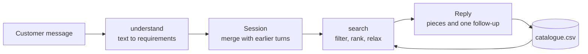

# Jewellery Shopping Assistant (demo)

A conversational assistant that finds jewellery from a sentence. Instead of picking a category, stacking filters and scrolling through hundreds of products, the customer says what they want, such as the occasion, the budget and the style, and the assistant shows matching pieces and asks one follow-up question.

> This is a clean-room demonstration. The code is not client code, and the catalogue, names, weights and prices it uses are generated, with invented metal rates. The understanding step is rule-based so the demo runs with no API key and gives the same answers every time. The screenshot below is a separate illustration.

## The assistant on a storefront


*A customer asks for "rose gold ring under 15000". The assistant replies with how many pieces matched, shows the requirements it picked up as chips (Rose gold, Rings, Up to ₹15,000), and lists the most loved results.*

This repo includes a plain chat page (`run.bat web`) so you can try the same kind of conversation yourself.

## What it shows

- **Natural-language requirements.** One sentence is turned into structured requirements: type of piece, metal, stone, budget, occasion, style and who it is for. Amounts like `60,000`, `5k`, `1.5 lakh`, `rs 40000` and ranges like `20 to 30k` are understood, and so are phrases like `not too heavy`.
- **A conversation that remembers.** Requirements carry across turns, so "under 30,000" after "gold earrings for a wedding" refines the same search. "Cheaper please", "show me more" and "start over" all work.
- **One follow-up at a time.** If the type of piece, the budget or the occasion is missing, it asks about one of them, in that order, and still shows pieces in the meantime.
- **Honest when nothing fits.** If no piece matches everything, it loosens requirements gently (stone, then lightweight, then budget, then metal, then type) and says which one it loosened.
- **Two ways to try it.** A scripted demo or terminal chat, and a small browser chat that runs on your own computer.

## Quick start

Requires Python 3.9 or newer. Nothing to install.

```bash
# macOS or Linux
./run.sh

# Windows
run.bat
```

| Command | What it does |
|---|---|
| `run.bat` or `./run.sh` | Plays a scripted conversation |
| `run.bat chat` | Talk to the assistant in the terminal |
| `run.bat web` | Chat in the browser at http://127.0.0.1:8000 |
| `run.bat test` | Runs the unit tests |
| `python -m jewel_assistant generate --count 500 --seed 3` | Writes a new made-up catalogue |

## Sample conversation

Output from `run.bat`, lightly trimmed.

```
You: Something for my sister's wedding, gold, under 60,000, not too heavy

Assistant: Here is what I found for lightweight gold jewellery, under ₹60,000, for your sister's wedding:

1. Veda Grand Pearl Ring: ₹27,600, gold, pearl, 3.5 g (suits a wedding, lightweight)
2. Mira Heritage Ruby Pendant: ₹24,500, gold, ruby, 2.7 g (suits a wedding, lightweight)
3. Zoya Floral Earrings: ₹21,200, gold, 2.8 g (suits a wedding, lightweight)

Are you thinking of a ring, earrings, a necklace or something else?

You: cheaper please

Assistant: Here is what I found for lightweight gold jewellery, under ₹22,000, for your sister's wedding:

1. Zoya Floral Earrings: ₹21,200, gold, 2.8 g (suits a wedding, lightweight)
2. Kavya Minimal Pearl Ring: ₹21,300, gold, pearl, 2.6 g (lightweight)
3. Mira Plain Pendant: ₹12,700, gold, 1.6 g (lightweight)

You: start over. simple silver earrings for daily wear, around 5k

Assistant: Here is what I found for simple silver earrings, between ₹4,000 and ₹6,000, for everyday wear:

1. Zoya Cascade Pearl Earrings: ₹4,700, silver, pearl, 10.8 g
2. Tara Cluster Pearl Earrings: ₹4,400, silver, pearl, 8.9 g
```

## How it works



| Step | File | What it does |
|---|---|---|
| Understand | `understand.py` | Reads type, metal, stone, budget, occasion, style, recipient and intent (search, cheaper, more, start over) from the text |
| Remember | `assistant.py` | Merges new requirements into the session. A different type of piece starts a fresh search, so a silver budget for earrings does not carry over to a diamond ring |
| Search | `search.py` | Type, metal, stone, budget and "not heavy" filter. Occasion, style and lightweight rank. Weight is judged against other pieces of the same type |
| Reply | `assistant.py` | Writes the reply with the reasons each piece fits, and asks about the first missing detail |

Prices are shown with Indian digit grouping, such as `₹1,50,000`.

## Using an LLM for understanding

`understand()` has one contract: text in, an `Understanding` out (a `Requirements` object plus an intent). The rule-based version can be swapped for an LLM call that returns the same fields, and search, the session and the reply logic stay as they are. The demo keeps it rule-based so it runs offline and the tests are deterministic.

## The web chat

`run.bat web` starts a small server using only the standard library. It listens on `127.0.0.1`, so only your own computer can reach it, and it keeps sessions in memory. The page is `jewel_assistant/static/index.html` and the endpoint is `POST /api/chat` with `{"session_id": "...", "message": "..."}`.

## Project layout

```
jewel_assistant/
  catalog.py       generated catalogue (names, weights, prices, styles, occasions)
  understand.py    sentence to requirements
  search.py        filtering, ranking, relaxing
  assistant.py     session, replies, follow-ups
  web.py           local web server
  static/index.html
  cli.py           demo, chat, web, generate
sample_data/catalogue.csv    240 made-up products
tests/                       28 tests
run.sh, run.bat              one-command runners
```

## Tests

```bash
run.bat test        # or ./run.sh test
```

The tests cover amount and range parsing, units that are not budgets (`22k gold`, `10 grams`), types and occasions, filtering and relaxing, the conversation flow (remembering, cheaper, more, start over, type change) and the web endpoints. One test checks that `sample_data/catalogue.csv` is exactly what the generator produces.

## Limits

- It understands English plus a handful of Hindi and Indian-market words (`shaadi`, `kada`, `payal`, `jhumka`, `diwali`). Other phrasing needs new rules or an LLM.
- Requirements come from keywords, so it will not catch negations beyond `not too heavy`.
- The catalogue is generated, with no images and no stock.
